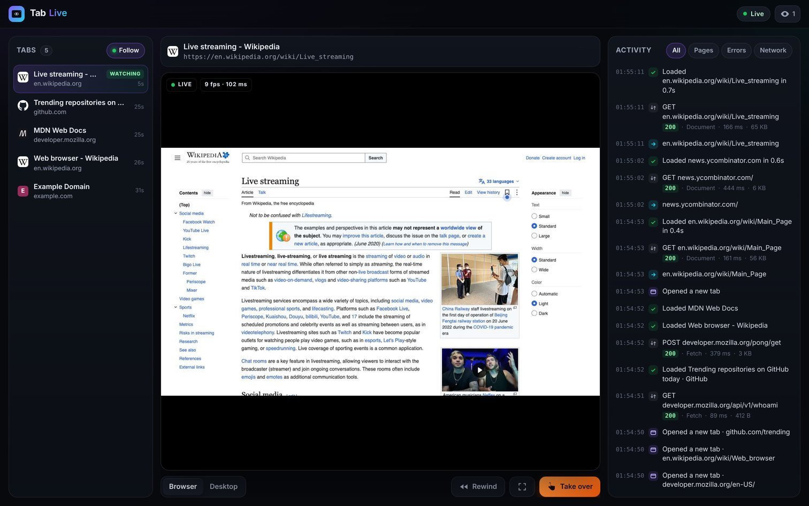
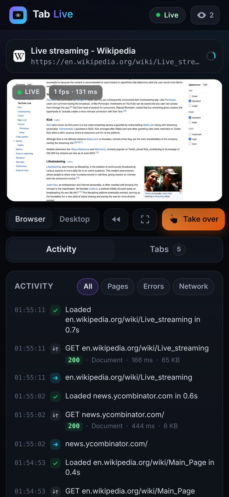
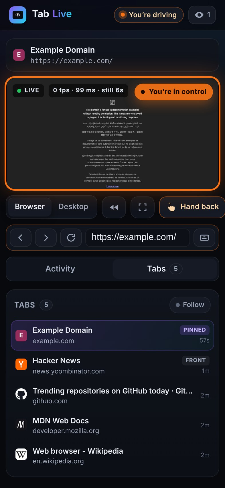
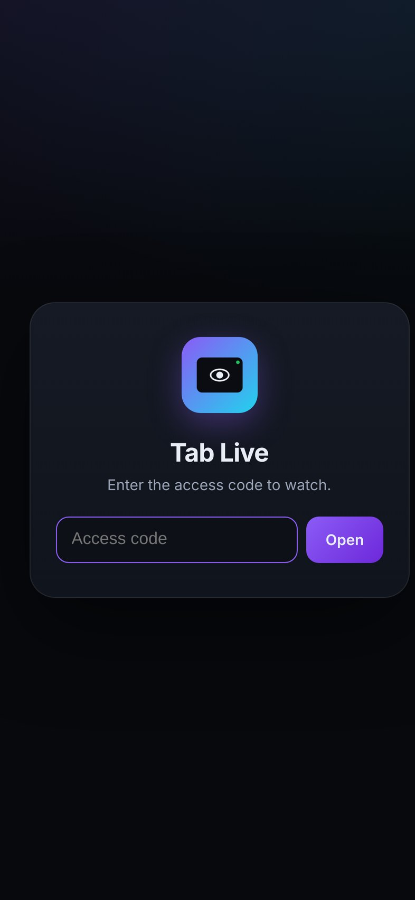
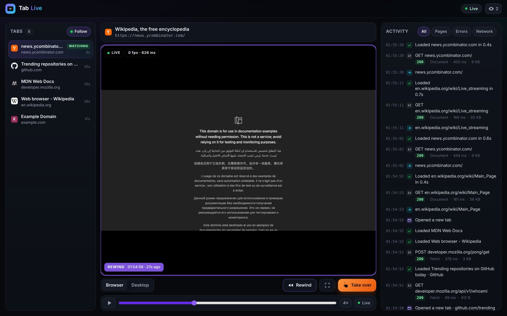

# Tab Live

**Watch your AI agent's browser live, from your phone, 24/7. On your own machine.**

Hosted browser services give you a live view of the agent's session. Tab Live gives you the same thing for a Chrome that runs on *your* Mac: a real-time stream of whatever tab the agent is working in, every open tab, a running activity log, a rewind buffer, and a **Take over** button for when you want to drive yourself. Nothing leaves your network.

<p align="center">
  
</p>

<p align="center">
  
  &nbsp;
  
  &nbsp;
  
</p>

## What you get

- **Live view of the active tab.** Chrome's own screencast (CDP `Page.startScreencast`) streams JPEG frames over a WebSocket. Frames are flow-controlled per viewer, so a phone on a slow link gets fewer frames instead of a growing delay. Typical glass-to-glass latency is about 100 ms over a VPN.
- **Follows the agent.** It figures out which tab the agent is in (newest navigation, new tabs, focus and visibility) and switches on its own. Tap a tab to pin it. Tap **Follow** to go back to auto.
- **Every tab.** Each open tab is listed with its title, URL, favicon, loading state and when it was last active.
- **Activity feed with timestamps.** Navigations, page loads, tabs opening and closing, failed and 4xx/5xx requests, browser-reported console errors, dialogs, and take-overs. Background tabs that poll all day (mail, dashboards) are kept out of the network list. Everything is also written to a daily JSONL file, kept for 7 days.
- **Rewind.** The last 15 minutes are kept in memory at 2 fps. Scrub back and play it at 1× to 16×.
- **Take over.** View-only by default. Take over to forward clicks, typing, paste, scrolling and touch (tap to click, drag to scroll, plus an on-screen keyboard). You also get back, forward, reload and an address bar. Everyone watching sees who is in control, control returns automatically after 3 idle minutes, and the agent can check `takeover.json` (or `GET /api/takeover`) to pause itself while you drive.
- **Whole desktop (optional).** A tiny helper app captures the agent user's entire screen, but only while someone has the Desktop view open.
- **Built for the phone.** Dark, mobile-first PWA. Add it to your Home Screen and it opens full screen like an app. A full-screen mode works for landscape.
- **Self-healing.** If the browser isn't running you get a calm idle screen, and it reconnects on its own when Chrome comes back. The server runs under launchd with KeepAlive.

<p align="center"></p>

## How it works

```
 agent's Chrome  ──CDP (loopback only)──▶  tab-live server (Node)  ──WebSocket──▶  your phone / laptop
 --remote-debugging-port                    · screencast + flow control           (token required,
                                            · tab tracking + activity log          VPN or loopback only)
                                            · rewind ring buffer
 Tab Live Capture.app ──desktop.jpg──▶      · take-over input (only while you hold control)
```

- One dependency (`ws`), with no build step and no framework.
- **Stealth-safe by default.** The server never calls `Runtime.enable` on pages. Anti-bot scripts can detect DevTools clients that serialize console arguments, so leaving it off keeps the agent's browser looking ordinary. Page reads such as title and visibility run in a private isolated world. Console errors come from the browser's `Log` domain. Set `fullConsole: true` if you want every `console.error` and uncaught exception, and you're fine with that trade-off.
- **Read-only unless you take over.** Input methods (`Input.*`, `Page.navigate`, `Target.activateTarget`) are only called for the viewer who currently holds control. Every other viewer is refused by the server, not just by the UI.

## Security model

- **Never listens on all interfaces.** You list exact addresses, for example `127.0.0.1` plus your Tailscale IP. `0.0.0.0` and `::` are refused at startup. Addresses that come up late, like a VPN after boot, are retried until they bind.
- **Access token.** 18 random bytes, generated on install and stored at `~/.config/tab-live/token` (mode 600), outside the repo. Every API call and the WebSocket need it. The UI keeps it in the URL *fragment* (`#token=…`), which browsers never send over the network, so Add to Home Screen keeps working. Comparisons are constant-time, and failed attempts are throttled per IP.
- **Host header allow-list.** Blocks DNS-rebinding tricks.
- **Strict headers.** CSP, no framing, no referrer, no third-party assets.
- **Chrome stays private.** The DevTools port stays on loopback, and only this server talks to it.

Put it behind [Tailscale](https://tailscale.com) (or another private network) and you can open it from anywhere without exposing anything publicly.

## Install (macOS)

Requirements: Node 20+ (`brew install node`), the Xcode Command Line Tools if you want the desktop view, and a Chrome started with a debugging port, for example:

```bash
open -na "Google Chrome" --args --user-data-dir="$HOME/agent-chrome" --remote-debugging-port=9222
```

Then:

```bash
git clone <this repo> ~/Developer/tab-live && cd ~/Developer/tab-live

# Recommended: a LaunchDaemon that runs as the agent's user and starts at boot,
# reachable on loopback and this Mac's Tailscale address.
sudo ./install.sh --user <agent-user> --cdp http://127.0.0.1:9222 --tailscale

# Or without sudo, as a LaunchAgent in your own login session:
./install.sh --mode agent --cdp http://127.0.0.1:9222 --tailscale
```

The installer:

- installs the dependencies
- writes `~/.config/tab-live/config.json`
- generates the token
- renders the launchd plists from `launchd/*.template`, backing up any existing ones
- builds and loads the desktop helper
- prints the URLs to open

Logs go to `~/Library/Logs/tab-live/`.

Open `http://<address>:8335/#token=<token>`, then **Share → Add to Home Screen** on iPhone.

### Desktop view: one permission

macOS asks you to approve screen capture yourself; it won't show a prompt to a background helper. Do this once, on the Mac:

1. Open **System Settings → Privacy & Security → Screen & System Audio Recording**.
2. Click **+**, then press **⌘⇧G**.
3. Open `<install dir>/build/` and add **Tab Live Capture**.
4. Make sure it's switched on.

The helper only captures while a viewer has the Desktop view open, plus one still image a minute.

### Seeing the agent's whole desktop with Screen Sharing

If the agent runs in its own macOS user, you can also use Apple Screen Sharing (System Settings → General → Sharing → Screen Sharing). Connect to `vnc://<address>`, sign in as the agent's user, and choose **Log in as yourself** if asked. That gives you the agent's own session instead of whoever is at the physical screen. Tab Live's Desktop view gives you a quick look; Screen Sharing gives you the full desktop.

## Configuration

`~/.config/tab-live/config.json`. Each key can also be set with an environment variable `TAB_LIVE_<KEY>`.

| key | default | |
|---|---|---|
| `hosts` | `127.0.0.1` | comma-separated listen addresses (never `0.0.0.0`) |
| `port` | `8335` | |
| `cdpUrl` | `http://127.0.0.1:9222` | the agent Chrome's DevTools HTTP endpoint |
| `name` | `Tab` | shown in the header |
| `quality` / `maxWidth` | `60` / `1600` | screencast JPEG quality and max frame size |
| `replayMinutes` / `replayFps` / `replayMaxMB` | `15` / `2` / `400` | rewind buffer |
| `takeoverIdleSec` | `180` | control returns automatically after this long without input |
| `fullConsole` | `false` | enable the Runtime domain for full console capture (see above) |
| `activityDays` | `7` | days of JSONL activity logs to keep |

## API

All routes except `/healthz` need `Authorization: Bearer <token>` (or `?t=`).

- `GET /api/state` — browser status, tabs, active tab, viewers, take-over
- `GET /api/feed` — recent activity events
- `GET /api/takeover` — `{active, by, since}`. Agents can poll this, or read `~/.config/tab-live/takeover.json`, to hold off while a human drives.
- `GET /api/frame.jpg` — the latest frame
- `GET /api/replay/index`, `GET /api/replay/frame/:seq` — the rewind buffer
- `WS /ws?t=<token>` — live state, feed and binary frames

## Uninstall

```bash
sudo ./uninstall.sh <agent-user>   # leaves the token and logs in place
```

## License

MIT
